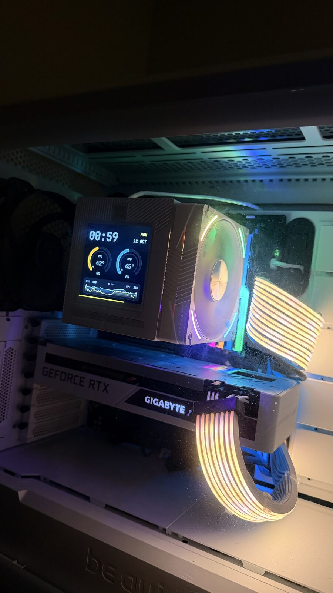
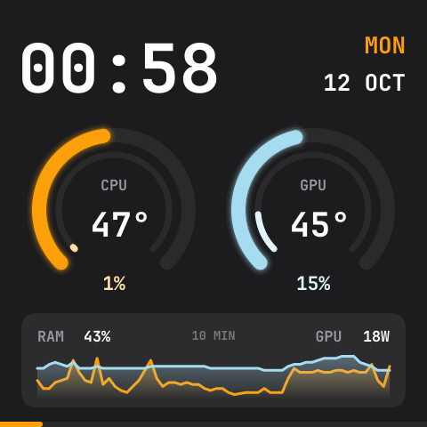
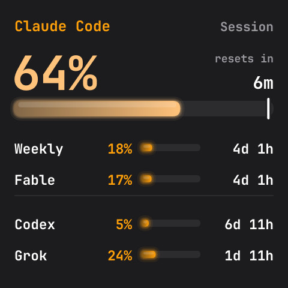
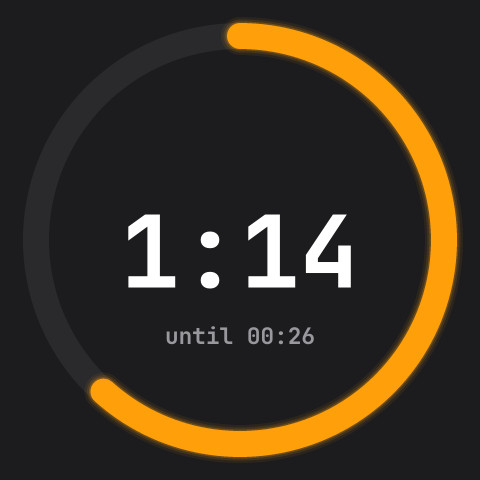

<h1 align="center">cooler-lcd</h1>

<p align="center">
  Live screens for the LCD on Thermalright Vision CPU coolers,<br>
  drawn in the colors and font of your Omarchy theme.
</p>

<p align="center">
  
</p>

A tiny driver for the 480x480 screen on Thermalright Vision coolers (USB
`87ad:70db`, e.g. Phantom Spirit 120 Vision), and a lightweight replacement
for TRCC. It cycles through screens, follows theme switches live, and takes
commands from scripts and Claude Code hooks.

## Screens

<table>
  <tr>
    <td valign="top" width="50%">
      <p align="center">
        
      </p>
      <b><code>dashboard</code></b>: the clock and date, a ring gauge each for
      the CPU and GPU (temperature outside, load inside), memory, GPU power,
      and the last ten minutes of temperatures as a chart.
    </td>
    <td valign="top" width="50%">
      <p align="center">
        
      </p>
      <b><code>usage</code></b>: Claude Code, Codex and other agents' plan
      usage, in type big enough to read from your chair: the main agent's
      headline limit as a huge percentage over a bar with a pace marker, and
      the time until it resets, then one line each for the rest.
    </td>
  </tr>
</table>

**`radar`**: a surveillance radar scope over Reykjavik and Keflavik with live
air traffic: a rotating sweep, range rings, the coastline, runways and their
extended centerlines, arrivals and departures with their runway
(`ARR ICE614 BIKF 19`), and each aircraft with its history trail, velocity
vector and data block (callsign, altitude in hundreds of feet,
climb/descent, ground speed). The map can be turned to face the way the
panel does, so traffic on the screen's right is off to your right.

With more than one screen on, a thin bar along the bottom edge counts down
to the next. A screen with news (a hot CPU, a nearly spent limit, an
emergency squawk) takes over the panel, and while the desktop is locked a
dim clock stands in for them all.

**Lightweight:** ~0.5% of one core for the still screens, ~2.5% while the
animated radar is up, and ~35 MB of memory (most of that is NVIDIA's NVML
library, loaded for the GPU readings).

## Install

```sh
cargo install --path .
sudo cp dist/70-cooler-lcd.rules /etc/udev/rules.d/ && sudo udevadm control --reload && sudo udevadm trigger
cp dist/cooler-lcd.service ~/.config/systemd/user/
systemctl --user enable --now cooler-lcd
```

The udev rule gives the logged-in user access to the screen and keeps USB
autosuspend off for it.

If TRCC is installed, keep it from grabbing the screen on login: remove any
`trcc` line from `~/.config/hypr/autostart.lua`, and add `Hidden=true` to
`~/.config/autostart/trcc.desktop`.

### Day to day

```sh
journalctl --user -u cooler-lcd                              # logs
cargo install --path . && systemctl --user restart cooler-lcd # deploy changes
systemctl --user stop cooler-lcd                             # hand the screen back to TRCC
```

## Control

The running service takes commands over a socket at
`$XDG_RUNTIME_DIR/cooler-lcd.sock`, readable only by you; without
`XDG_RUNTIME_DIR` there's no socket (`src/control.rs`):

```sh
cooler-lcd next                        # show the next screen
cooler-lcd show radar                  # jump to a configured screen
cooler-lcd on radar                    # put a screen in the rotation and show it
cooler-lcd off radar                   # take it out again
cooler-lcd toggle radar                # one or the other; prints which
cooler-lcd flash "Build finished"      # show a message for one rotation
cooler-lcd snapshot panel.jpg          # save what the panel shows as a JPEG
cooler-lcd timer 25m                   # count down on the panel (1h30m, 90s, 25)
cooler-lcd timer stop                  # cancel it
```

A screen that's off is skipped by the rotation and never takes over the
panel (the radar doesn't fetch traffic either), but `show` still brings it
up for one turn. It starts off again when the service restarts if the
config lists it under `off`.

<p align="center">
  
</p>

A timer holds the panel while it runs: a huge ring running down around the
minutes and seconds left. The rotation and takeovers wait, and `next` and
`show` are refused, though a flash still shows over it for its rotation.
When time's up it counts the time since until `cooler-lcd next` (or
`timer stop`) dismisses it. It runs on the wall clock, so time spent
suspended counts.

While the desktop is away, `next` and `show` are refused, but a flash still
shows over the dim clock for its rotation, and so does a running timer.
One that's up waits behind the clock until you're back.

To have the cooler show Claude Code's notifications (permission prompts,
waiting for input), add a `Notification` hook to `~/.claude/settings.json`:

```json
"Notification": [
  {
    "hooks": [
      {
        "type": "command",
        "async": true,
        "command": "cooler-lcd flash \"$(jq -r '.message // \"Claude needs you\"')\" >/dev/null 2>&1 || true"
      }
    ]
  }
]
```

## Config

Optional, at `~/.config/cooler-lcd/config.toml` (see `dist/config.toml`):

```toml
screens = ["dashboard", "usage", "radar"]   # shown in order
off = ["radar"]           # configured, but out of the rotation until `cooler-lcd on`
rotate_seconds = 15       # time per screen when more than one is listed
rotate_bar = true         # the bar counting down to the next screen

[radar]
heading = 0               # compass bearing at the top of the scope (0 = north up)
center = [64.05, -22.25]  # [latitude, longitude] at the middle of the scope
```

For `heading`, use the direction you face when you look at the panel. The
bezel's labels stay true compass bearings and an N marks north. `center`
can be your home: the config file stays on your machine, and adsb.fi is
only asked about a spot rounded to 0.1 degrees.

Restart the service after editing it. A broken config is logged and the
defaults are used.

## How it works

- **Screen:** a 480x480 panel that only accepts whole pictures. Each frame is a
  64-byte header + JPEG sent over USB bulk (`src/device.rs`). The firmware
  falls back to the Thermalright logo after ~2-3 s without a frame, so the last
  frame is resent every second.
- **Screens:** each screen in `src/screens/` gathers its own data and draws
  itself with the helpers in `src/draw.rs`. A frame is redrawn and re-encoded
  only when the screen reports a change, the theme changes, or the next screen
  rotates in (`src/render.rs`). Still screens run at one frame a second;
  animated ones set their own `interval()`.
- **Rotation bar:** with more than one screen on, a thin bar along the
  bottom edge fills up as the next screen draws near, at 30 fps. Frames are
  encoded with a JPEG restart marker after every row of blocks, so moving
  the bar re-encodes only the bottom row and splices it into the last
  frame: about 0.1% of a core.
- **Takeovers:** while the carousel is showing, every screen is asked about
  once a second what needs attention, even while it's hidden. When something
  starts, its screen jumps the queue and stays up for a full rotation, and
  screens with news at the same time take turns: the dashboard when the CPU
  or GPU reaches 85° (it must cool below 75° to trigger again), usage when a
  plan limit passes 90%, and the radar on an emergency squawk or an
  Icelandair flight on approach. A condition that lasts doesn't pin its
  screen, and one only takes over again after ten minutes unseen, so
  flickering at a threshold doesn't keep grabbing the panel. The radar only
  sees traffic while it has been on screen recently, since it doesn't fetch
  just to check.
- **Sensors:** CPU temperature from hwmon (`k10temp` Tdie/Tctl,
  `coretemp`), CPU load and memory from `/proc`, GPU temperature, load and
  power from NVML, polled every 3 s. Missing sensors are retried every 30 s
  (`src/screens/sensors.rs`).
- **Theme:** colors from `~/.local/state/omarchy/current/theme/colors.toml`,
  font from `omarchy-font-current` via fontconfig, falling back to the system
  sans (`src/theme.rs`). Both are reloaded when `colors.toml` or
  `~/.config/fontconfig/fonts.conf` changes.
- **Plan usage:** read from the records Omarchy's Agents bar widget
  (`omarchy.agents`) writes to `~/.local/state/omarchy/agents/usage/`, one
  JSON file per agent, re-read whenever one changes. No network and no
  credentials of its own; the numbers are as fresh as the bar's (every 15
  minutes by default, `omarchy bar set omarchy.agents refreshIntervalSec 300
  --json` for 5). The big bar's notch marks where an even spend across the
  window would be by now, and records older than 45 minutes are dimmed with
  their age (`src/screens/usage/`).
- **Radar:** aircraft from [adsb.fi](https://adsb.fi)'s open data API
  (community ADS-B receivers, no key, personal non-commercial use), polled
  every 10 s only while the radar is on screen, backing off on errors and
  slowing down on HTTP 429. ([adsb.lol](https://adsb.lol) serves the same
  format but kept rate limiting it.) Positions are dead reckoned
  between polls, so blips glide at the 15 fps animation rate. The static
  scope, rings and map are drawn once per theme. Coastline from Natural
  Earth, runways from OurAirports (`src/screens/radar/`).
- **Away:** while the Hyprland session is locked or every monitor is off,
  a dim clock replaces the screens, which stop updating, so the radar stops
  fetching and plan usage isn't on display. Checked every 2 s over
  Hyprland's IPC socket (`src/desktop.rs`).
- **Recovery:** a sender thread owns the panel and resends the latest frame
  every second whatever the frame loop is doing (`src/sender.rs`). It
  reconnects when the cooler is unplugged or a write fails, and after
  suspend (detected as the wall clock jumping ahead of the monotonic
  clock).

## Development

```sh
cargo run --release                                          # drive the screen
cargo run --release -- --preview out.jpg                     # render one frame to a file
cargo run --release -- --screen dashboard --preview out.jpg  # preview a specific screen
cargo test                                                   # unit tests
```

Only one program can use the screen at a time, so stop the service (or TRCC,
with `trcc kill`) first. A preview starts from scratch, so the dashboard's
load and chart are empty; `cooler-lcd snapshot` saves what the running
service shows instead.

### Adding a screen

Implement the `Screen` trait in a new module under `src/screens/` and register
it in `build()` and `NAMES` in `src/screens/mod.rs`. `update()` runs inside the
frame loop, so fetch anything slow (network, big files) on a background thread.
Implement `alerts()` to take over the panel when something happens.

## License

MIT, see [LICENSE](LICENSE).
